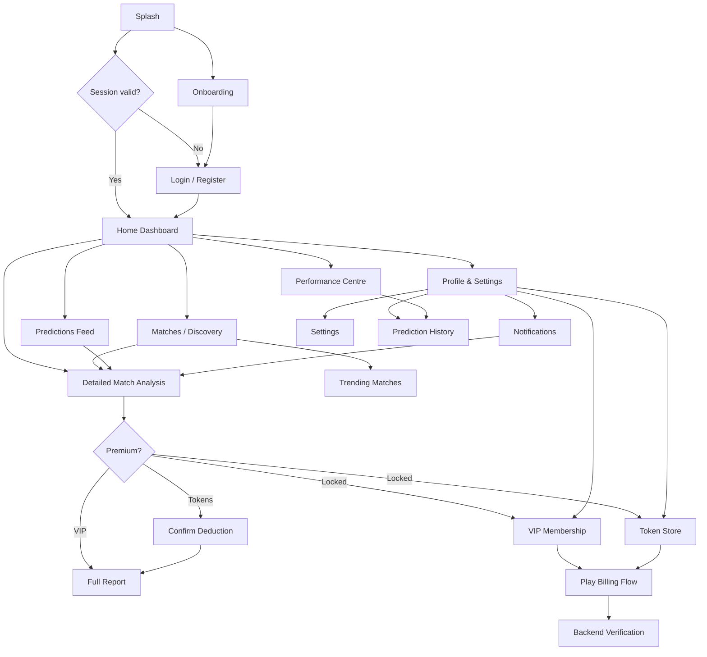

# Prediqo — User Journeys & UI Navigation Map (Phase 0)

---

## 1. Primary navigation (five destinations)

```
Bottom navigation bar
┌──────────┬──────────┬──────────────┬──────────────┬──────────┐
│  Home    │ Matches  │ Predictions  │ Performance  │ Profile  │
└──────────┴──────────┴──────────────┴──────────────┴──────────┘
```

**Secondary destinations (reachable via icons/menus, not crowded into the bar):**
VIP Membership, Token Store, Notifications, Search, Settings.

---

## 2. Navigation graph



**Routes (GoRouter):**
`/splash`, `/onboarding`, `/login`, `/home`, `/matches`, `/matches/trending`,
`/matches/:id`, `/predictions`, `/performance`, `/history`, `/vip`, `/tokens`,
`/notifications`, `/profile`, `/settings`, `/search`.

---

## 3. Core user journeys

### J-01 First-time user
Splash → onboarding (skippable) → register (email or Google) → home → browse today's
fixtures → open a free match analysis → see probabilities and explanation → prompted to
register/save favourites.

### J-02 Free user checking daily picks
Login/session restore → home → "Today's Predictions" → select match → see basic 1X2
and goals probabilities → premium sections show locked preview with clear price →
option to buy tokens or view VIP.

### J-03 Token unlock
Open premium report → preview + price shown → confirm dialog showing balance and cost →
backend checks entitlement (VIP first), validates balance, creates debit transaction and
unlock record atomically → full report becomes available. Duplicate request with same
idempotency key returns the same result.

### J-04 VIP subscriber
Home shows VIP badge → all included features open without prompts → no ads → "Restore
purchases" and "Manage subscription" available in VIP screen → subscription status and
renewal date from backend.

### J-05 Performance review
Performance centre → overview with sample sizes → filter by market/competition →
calibration chart → open history → inspect settled predictions.

### J-06 Purchase with weak connectivity
User completes Play purchase → app queues verification → backend verifies with Play API
when reachable (or polling job picks it up) → entitlement synchronised → user notified.
No entitlement granted from client-side success alone.

### J-07 Admin correction
Admin opens prediction → records correction with reason → new superseding record created,
original immutable → audit log entry written → performance analytics recomputed from
event stream.

---

## 4. Reusable design system (to be implemented in Phase 4)

| Layer | Elements |
|---|---|
| Colour | Deep black/charcoal backgrounds, neon green primary, white primary text, light grey secondary text, subtle blue secondary accent. Dark default, light theme variant. |
| Typography | Display / headline / title / body / label / caption scale using a single family (e.g. Inter or system font). |
| Spacing | 4/8/12/16/24/32 dp scale; consistent card padding and list gaps. |
| Components | `PrediqoButton`, `PrediqoCard`, `MatchCard`, `ProbabilityBar`, `SectionHeader`, `PremiumBadge`, `StatTile`, `EmptyState`, `ErrorState`, `ShimmerLoading`, `ConfirmDialog`, `ChartCard`. |
| Navigation | Bottom nav, app bar, back handling, deep links. |
| States | Loading, empty, error (with retry), offline, locked/premium. |
| Charts | fl_chart bars, line, pie/donut; accessible colours and labels. |

No screen may hard-code colours or dimensions; everything consumes theme tokens.

---

## 5. Screen inventory (13 screens from brief)

1. Splash
2. Onboarding
3. Home dashboard
4. Match discovery
5. Trending matches
6. Detailed match analysis
7. Predictions
8. Performance centre
9. Prediction history
10. VIP membership
11. Token store
12. Notifications
13. Profile & settings

Admin dashboard is a separate web application (Phase 9).
