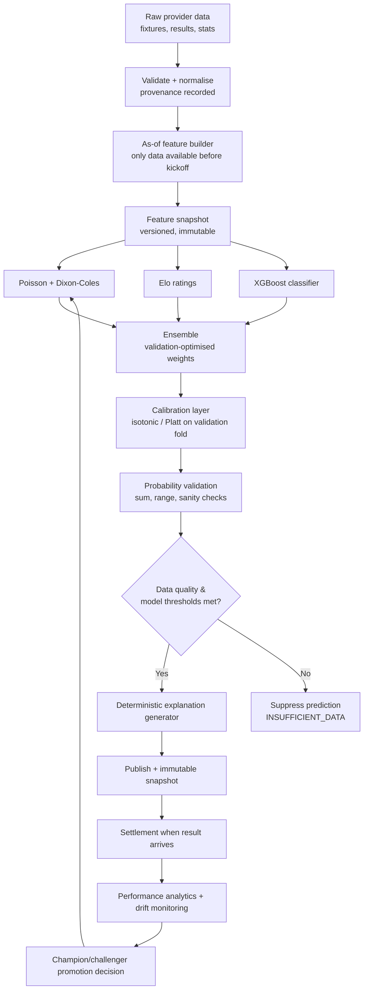

# Prediqo — AI/ML Prediction Architecture (Phase 0)

**Principle:** a general-purpose LLM is **never** the numeric prediction engine.
Probabilities come from validated statistical/ML models. The LLM (if introduced later)
only reformats already-verified model facts into prose.

---

## 1. Pipeline



---

## 2. Models

### 2.1 Poisson goal model (primary market engine)
- Two independent Poisson processes for home and away goals with rates λh, λa.
- λ estimated from attacking/defensive strength and league average, using a
  **Dixon–Coles low-score correction** for the 0-0, 1-0, 0-1, 1-1 bias of naive Poisson.
- Score matrix 0..N goals per side; derive:
  - 1X2 (sum matrix regions),
  - over/under 0.5/1.5/2.5/3.5,
  - BTTS (both ≥1),
  - correct-score distribution (top-N published with remainder bucket),
  - half-time markets only if provider supplies half-time goal statistics.
- **Assumptions** documented: independence, stationarity within season, no in-game
  dynamics. Limitations shown in the app explanation.

### 2.2 Elo ratings
- Football-adapted Elo: home advantage term, margin-of-victory multiplier,
  expected-result update, seasonal regression to mean, recency weighting.
- Produces team-strength ratings and a prior that feeds λ estimation and XGBoost.
- Ratings are recomputed from historical results with point-in-time values.

### 2.3 XGBoost
- Targets: 1X2 class, over/under 2.5, BTTS, and (where supported) corners over/under.
- Features (all strictly pre-kickoff): rolling form (W/D/L, goals for/against, xG for/against),
  Elo differential, home/away splits, rest days, days since last match, competition/season
  encoded, team strength, H2H sample-limited aggregates, provider data completeness score.
- Missing features imputed with explicit missingness indicators; never fabricated values.

### 2.4 Ensemble
- Candidates evaluated independently first. Weights optimised on a validation fold to
  minimise **log loss** with constraints (non-negative, sum to 1). No blind averaging.
- Calibration: isotonic (sufficient data) or Platt scaling (small samples) fitted on a
  held-out chronological fold, then applied to production outputs.
- Champion/challenger: a new model version must beat the champion on Brier score and log
  loss with significance checks before promotion. Every prediction stores `model_version_id`.

### 2.5 Explanation layer
**v1 (recommended):** deterministic templates rendered from a structured object
containing only verified facts and model outputs:

```
"Home are estimated at 45% (model v3.2, as of 24 Nov 06:00 UTC). The main drivers
were a +62 Elo advantage and stronger recent home xG (1.72 vs 1.18). Estimates
assume form is stable; 18 prior matches were available. Corners data was unavailable,
so no corner market is published."
```

**Optional later:** LLM with strict constraints —
- input is a closed JSON fact schema, no free-text provider content;
- output validated against a JSON schema;
- post-check: every number/token in the output must exist in the supplied fact object;
- system prompt forbids adding injuries, lineups or events;
- prompt-injection defence: provider text is treated as untrusted data, never instructions.

---

## 3. Validation & leakage prevention

| Requirement | Implementation |
|---|---|
| Chronological splits | Train on seasons up to T, validate T+1, test T+2; never random shuffle across time. |
| Walk-forward validation | Rolling origins across multiple seasons; report mean/variance of metrics. |
| Data leakage | Feature builder receives `as_of = kickoff_utc`; any record with timestamp after kickoff is excluded by construction and by test. |
| Backtesting | Replay historical fixtures with only pre-kickoff features; compare to baseline (league average / Elo-only). |
| Metrics | Brier score (primary), log loss, accuracy (argmax), calibration curve/reliability diagram, per-market and per-competition metrics. |
| Sample sizes | Always report N; suppress metrics for N < 30. |
| Reproducibility | Fixed seeds, logged library versions, stored feature schema hash and model artifact hash in `model_versions`. |
| Drift | Monitor distribution of features and Brier score by week; alert on degradation > configured threshold. |
| Suppression | Minimum data quality score, minimum historical matches (e.g. 8–10 per team), minimum calibration quality; otherwise no prediction is published. |

**Explicit guardrails:** no guarantee language, no "sure wins", no financial-return claims,
predictions are informational estimates with uncertainty.

---

## 4. Publication & settlement logic

1. Build features from provider data with provenance; compute a `data_quality_score`.
2. Run eligible models; validate probability vectors (all in [0,1], correct length).
3. Apply largest-remainder rounding to basis points so mutually exclusive outcomes sum
   to 10,000.
4. Generate deterministic explanation from the same feature object.
5. Insert `predictions` row with immutable `snapshot_jsonb` including model version,
   feature version, `data_as_of`, `published_at`, probabilities and explanation facts.
6. Settlement job fetches official result, applies market-specific rules:
   - **Correct / Incorrect** for selected outcome vs actual;
   - **Void** for abandoned/cancelled matches;
   - **Postponed** → re-schedule and re-publish with a new snapshot; old record kept;
   - **Abandoned** → void;
   - **Rescheduled** → treat as new fixture linked to original.
7. Settlement writes to `prediction_settlements`; corrections append to
   `prediction_corrections` with a reason and actor.

---

## 5. Model evaluation storage

`model_evaluations` stores: dataset window, train/validation/test boundaries, N,
Brier, log loss, accuracy, calibration intercept/slope, per-market and per-competition
breakdowns, baseline comparison, artifact hash, and promotion decision. MLflow is
self-hosted (file store in dev) to avoid cloud cost.

---

## 6. Open decisions (product owner input required)

- Minimum sample-size thresholds per market.
- Acceptance thresholds for Brier/log loss before a model may publish.
- Whether to include first-half and corner markets at launch (depends on provider data).
- Whether to enable the optional LLM explanation layer at all in v1 (recommendation: no).
