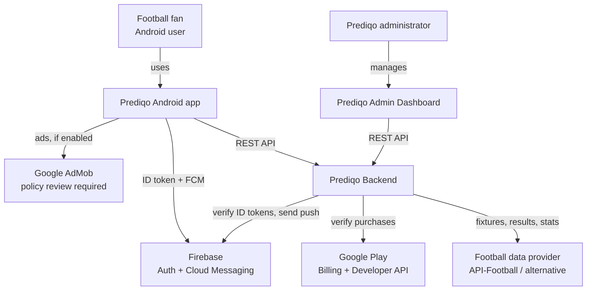
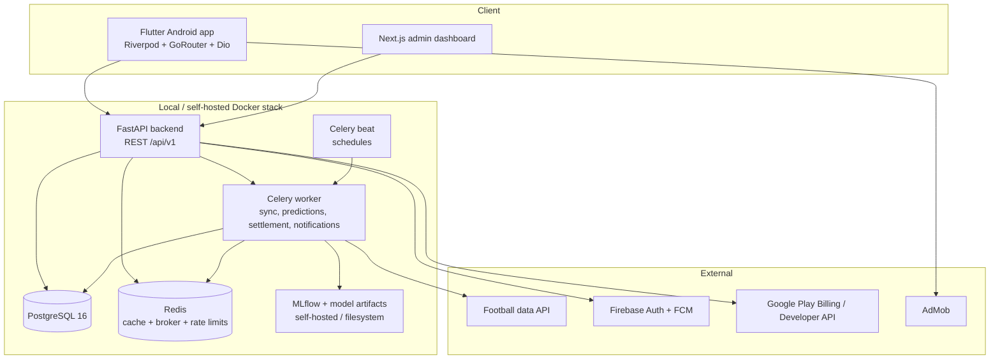
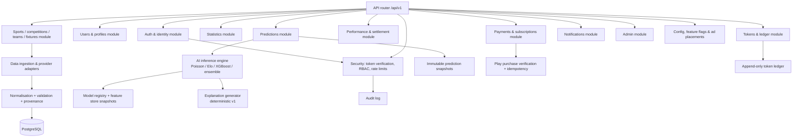
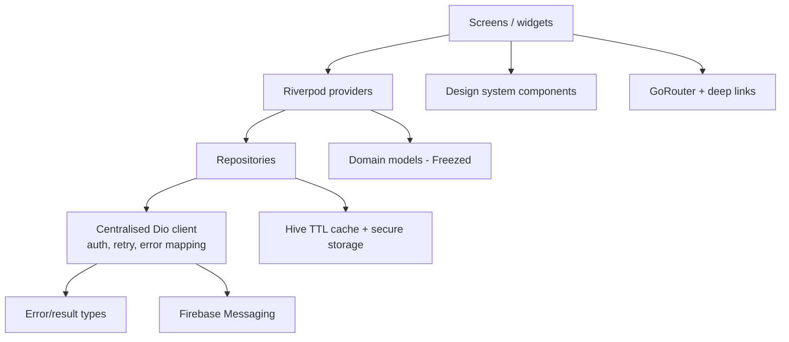
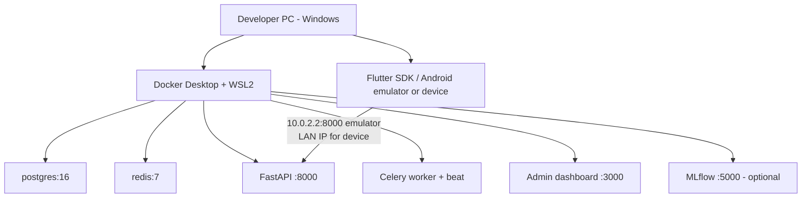

# Prediqo — C4 Architecture (Phase 0)

---

## Level 1 — System context

**Key boundary:** The mobile app never calls the data provider or Google Play Developer
API directly. Provider keys and Play credentials stay server-side.

---

## Level 2 — Containers

---

## Level 3 — Backend components (modular monolith)

**Module boundary rule:** modules communicate through typed service interfaces and
database tables, never by importing each other's internal routers. This permits a future
split into separate services without rewriting domain logic.

---

## Level 3 — Mobile components

---

## Deployment view (local-first)

---

## Architecture principles

1. Single source of truth for entitlements: PostgreSQL.
2. All external data normalised and validated before entering domain models.
3. All long-running work asynchronous and idempotent.
4. Every write to tokens, predictions or admin actions is auditable.
5. Configuration via environment variables; no secrets in images or repositories.
6. Caching at API and client layers with explicit TTLs and stale-while-revalidate.
