# Prediqo — Database ERD (Phase 0)

**Engine:** PostgreSQL 16. **Migrations:** Alembic. **Timezone:** all timestamps `TIMESTAMPTZ`, stored UTC.

---

## 1. Entity–relationship diagram

```mermaid
erDiagram
    USERS ||--o| PROFILES : has
    USERS ||--o{ USER_ROLES : assigned
    ROLES ||--o{ USER_ROLES : granted
    ROLES ||--o{ ROLE_PERMISSIONS : has
    PERMISSIONS ||--o{ ROLE_PERMISSIONS : included
    USERS ||--o{ USER_FAVORITE_TEAMS : favorites
    TEAMS ||--o{ USER_FAVORITE_TEAMS : favorited_by
    USERS ||--o{ USER_FAVORITE_COMPETITIONS : favorites
    COMPETITIONS ||--o{ USER_FAVORITE_COMPETITIONS : favorited_by
    USERS ||--o{ DEVICE_TOKENS : registers
    USERS ||--o{ AUDIT_LOGS : acts

    SPORTS ||--o{ COMPETITIONS : contains
    COMPETITIONS ||--o{ SEASONS : has
    COMPETITIONS ||--o{ FIXTURES : hosts
    SEASONS ||--o{ FIXTURES : groups
    TEAMS ||--o{ FIXTURES : home
    TEAMS ||--o{ FIXTURES : away
    FIXTURES ||--o{ MATCH_STATISTICS : measured_by
    FIXTURES ||--o{ TEAM_FORM : form_snapshots
    TEAMS ||--o{ TEAM_FORM : form_for
    TEAMS ||--o{ HEAD_TO_HEAD : team_a
    TEAMS ||--o{ HEAD_TO_HEAD : team_b
    TEAMS ||--o{ TEAM_SEASON_STATS : season_stats

    PREDICTION_MARKETS ||--o{ PREDICTIONS : categorises
    MODEL_VERSIONS ||--o{ PREDICTIONS : produces
    FIXTURES ||--o{ PREDICTIONS : predicted_for
    PREDICTIONS ||--o| PREDICTION_SETTLEMENTS : settled_by
    PREDICTIONS ||--o{ PREDICTION_CORRECTIONS : corrected_by
    MODEL_VERSIONS ||--o{ MODEL_EVALUATIONS : evaluated_by

    DATA_PROVIDERS ||--o{ SYNC_JOBS : executes
    DATA_PROVIDERS ||--o{ MATCH_STATISTICS : sources

    USERS ||--o| TOKEN_ACCOUNTS : owns
    TOKEN_ACCOUNTS ||--o{ TOKEN_TRANSACTIONS : records
    TOKEN_PACKAGES ||--o{ TOKEN_PURCHASES : purchased_as
    USERS ||--o{ TOKEN_PURCHASES : buys
    TOKEN_PURCHASES ||--o| TOKEN_TRANSACTIONS : credits

    SUBSCRIPTION_PLANS ||--o{ SUBSCRIPTIONS : subscribed_as
    USERS ||--o{ SUBSCRIPTIONS : holds
    SUBSCRIPTIONS ||--o{ SUBSCRIPTION_EVENTS : emits

    USERS ||--o{ NOTIFICATIONS : receives
    USERS ||--o| NOTIFICATION_PREFERENCES : configures

    SYSTEM_CONFIG ||--o{ AD_PLACEMENTS : configures
    AD_PLACEMENTS ||--o| SYSTEM_CONFIG : references
```

---

## 2. Core tables

### Identity & access
| Table | Key fields | Notes |
|---|---|---|
| `users` | `id` UUID PK, `firebase_uid` UNIQUE, `email`, `display_name`, `status`, `created_at`, `deleted_at` | Source of truth for identity linkage. |
| `profiles` | `user_id` PK/FK, `timezone`, `locale`, `theme`, `onboarding_completed_at` | Preferences. |
| `roles` | `id`, `code` (USER, VIP_USER, ADMIN, SUPER_ADMIN) | VIP_USER is *derived* from active subscription; may also be explicit for manual grants. |
| `permissions` | `id`, `code`, `description` | Fine-grained capabilities. |
| `user_roles` / `role_permissions` | join tables | RBAC. |
| `user_favorite_teams` / `user_favorite_competitions` | `(user_id, team_id/competition_id)` UNIQUE | Personalisation. |
| `device_tokens` | `(user_id, fcm_token)` UNIQUE, `platform`, `updated_at` | Push delivery + dedupe. |

### Sports domain
| Table | Key fields | Notes |
|---|---|---|
| `sports` | `id`, `code`, `name` | `football` first; future sports. |
| `competitions` | `id`, `sport_id`, `provider_id`, `country`, `name`, `tier`, `active` | UNIQUE(sport_id, provider_id). |
| `seasons` | `id`, `competition_id`, `label`, `start_date`, `end_date`, `is_current` | |
| `teams` | `id`, `sport_id`, `provider_id`, `name`, `short_name`, `country`, `logo_url` | UNIQUE(sport_id, provider_id). |
| `team_season_stats` | `team_id`, `season_id`, `stats_jsonb`, `as_of` | Aggregates snapshot. |
| `fixtures` | `id`, `provider_fixture_id` UNIQUE, `competition_id`, `season_id`, `home_team_id`, `away_team_id`, `kickoff_utc`, `status`, `venue`, `home_score`, `away_score`, `last_synced_at` | Index `(kickoff_utc, status)`, `(competition_id, kickoff_utc)`. |
| `match_statistics` | `id`, `fixture_id`, `provider_id`, `stats_jsonb`, `captured_at` | goals, corners, xG, first-half, lineups; provenance required. |
| `team_form` | `team_id`, `as_of`, `window_matches`, `home_jsonb`, `away_jsonb`, `overall_jsonb` | Snapshot, never overwritten. |
| `head_to_head` | `team_a_id`, `team_b_id`, `as_of`, `matches`, `wins_a`, `draws`, `wins_b`, `goals_jsonb` | Sample size visible. |

### Predictions & model
| Table | Key fields | Notes |
|---|---|---|
| `prediction_markets` | `id`, `code` (1X2, DC, OU25, BTTS, CS, CORNERS, FH...), `group`, `active` | |
| `model_versions` | `id`, `name`, `version`, `feature_version`, `trained_at`, `metrics_jsonb`, `status` (champion/challenger/retired) | |
| `predictions` | `id`, `fixture_id`, `market_id`, `model_version_id`, `published_at`, `data_as_of`, `probabilities_jsonb`, `selected_outcome`, `status`, `snapshot_jsonb`, `explanation_jsonb` | **Immutable** snapshot. Index `(fixture_id, market_id, published_at DESC)`. |
| `prediction_settlements` | `prediction_id` PK/FK, `settled_at`, `result`, `actual_outcome`, `source`, `notes` | |
| `prediction_corrections` | `id`, `prediction_id`, `reason`, `supersedes_id`, `corrected_payload_jsonb`, `actor_user_id`, `created_at` | Append-only; original unchanged. |
| `model_evaluations` | `id`, `model_version_id`, `evaluated_at`, `metrics_jsonb`, `split_info_jsonb` | Brier, log loss, calibration, accuracy. |

### Data ingestion
| Table | Key fields | Notes |
|---|---|---|
| `data_providers` | `id`, `name`, `base_url`, `config_jsonb`, `enabled` | API key in env/secret, not here. |
| `sync_jobs` | `id`, `provider_id`, `job_type`, `status`, `started_at`, `finished_at`, `records_processed`, `error_text` | Failed-job monitoring. |

### Monetisation
| Table | Key fields | Notes |
|---|---|---|
| `token_packages` | `id`, `name`, `tokens`, `price_minor`, `currency`, `google_play_product_id`, `active` | Admin-configurable. |
| `token_accounts` | `user_id` PK/FK, `balance` INTEGER **CHECK (balance >= 0)**, `updated_at` | Balance is derived from ledger; constraint is a safety net. |
| `token_transactions` | `id`, `account_id`, `type` (CREDIT/DEBIT/REFUND/ADJUSTMENT), `amount`, `balance_after`, `reason`, `reference_type`, `reference_id`, `idempotency_key` UNIQUE, `created_at` | **Append-only.** Revoke UPDATE/DELETE for app role. |
| `token_purchases` | `id`, `user_id`, `package_id`, `google_play_order_id` UNIQUE, `purchase_token` UNIQUE, `status`, `purchased_at`, `verified_at`, `refunded_at` | Duplicate prevention. |
| `subscription_plans` | `id`, `code`, `interval`, `price_minor`, `currency`, `google_play_product_id`, `entitlements_jsonb`, `active` | |
| `subscriptions` | `id`, `user_id`, `plan_id`, `purchase_token` UNIQUE, `status`, `started_at`, `expires_at`, `canceled_at`, `grace_period_until`, `auto_renew` | |
| `subscription_events` | `id`, `subscription_id`, `type`, `payload_jsonb`, `idempotency_key` UNIQUE, `occurred_at`, `processed_at` | Renewal/expiry/refund stream. |

### Notifications, config, audit
| Table | Key fields | Notes |
|---|---|---|
| `notifications` | `id`, `user_id`, `type`, `title`, `body`, `deep_link`, `status`, `dedupe_key` UNIQUE, `sent_at`, `read_at` | |
| `notification_preferences` | `user_id` PK/FK, `preferences_jsonb` | Per-type + quiet hours in user timezone. |
| `system_config` | `key` PK, `value_jsonb`, `updated_by`, `updated_at` | Free limits, ad config, feature flags. |
| `ad_placements` | `id`, `key` UNIQUE, `enabled`, `frequency_cap`, `vip_excluded`, `config_jsonb` | Remote-configurable; all `enabled=false` until policy review. |
| `audit_logs` | `id`, `actor_user_id`, `actor_role`, `action`, `target_type`, `target_id`, `before_jsonb`, `after_jsonb`, `ip`, `user_agent`, `created_at` | Append-only, retained 12 months (proposed). |

---

## 3. Integrity rules

1. **UTC everywhere**; display conversion happens in the client.
2. **UNIQUE** on all provider IDs and external transaction/order IDs.
3. **CHECK** `token_accounts.balance >= 0`; all balance changes occur inside a transaction
   that inserts a ledger row with `SELECT ... FOR UPDATE` on the account row.
4. **Append-only tables** (`token_transactions`, `predictions`, `audit_logs`,
   `subscription_events`, `prediction_corrections`) — application DB role has no
   UPDATE/DELETE grant; corrections use compensating records.
5. **Numeric precision** for probabilities: `NUMERIC(7,6)` or integer basis points
   `INTEGER` (0–10,000) to avoid float drift. Recommended: store probabilities as integer
   basis points summing to 10,000; divide by 100 for display.
6. **Indexes** on `(kickoff_utc, status)`, `(fixture_id, market_id, published_at DESC)`,
   `(user_id, created_at DESC)`, and all FK columns.
7. **Migrations** via Alembic; seed data clearly flagged `is_sample_data=true` and never
   used as production predictions.
8. **Account deletion**: set `users.deleted_at`, null out PII, keep prediction records
   (non-personal analytics), keep ledger for financial integrity with pseudonymised user id.
