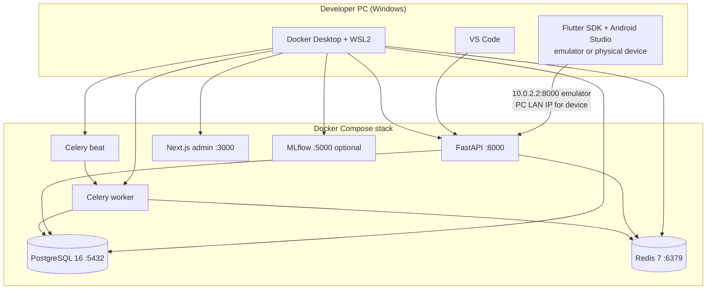

# Prediqo — Local Development & Optional Hosting (Phase 0)

---

## 1. Local development architecture (required, no cloud)



### Tooling to install in Phase 1
- Flutter SDK (stable) + Android Studio + Android SDK + emulator or physical device.
- Docker Desktop with WSL2 integration.
- Python 3.12+ (verify the Windows Store `python` is a real interpreter; install from
  python.org if needed), pip/venv.
- Node.js 20+ for the admin dashboard (already present).
- Git (already present).
- Optional: psql client, GitHub CLI.

### Android ↔ host connectivity
- Android emulator reaches host via `http://10.0.2.2:8000`.
- Physical device reaches host via LAN IP `http://<pc-ip>:8000` on the same network.
- `android/local.properties` and `google-services.json` are gitignored.

### Local commands (to be implemented in Phase 1)
```powershell
docker compose up -d --build          # all services
docker compose logs -f backend worker # logs
cd backend && alembic upgrade head    # migrations
cd backend && pytest                  # tests
cd mobile && flutter run              # app
cd admin-dashboard && npm run dev     # admin UI
```

### Database lifecycle
- `docker compose exec postgres pg_dump -U prediqo prediqo > backup.sql`
- Restore: `docker compose exec -T postgres psql -U prediqo prediqo < backup.sql`
- Seed data must set `is_sample_data = true` and never appear as production predictions.

---

## 2. Optional hosting approaches (evaluate later, no commitment now)

| Option | Pros | Cons | Indicative cost | Portability |
|---|---|---|---|---|
| **Local only** | $0, full control | Not publicly accessible | $0 | Maximum |
| **Self-hosted Linux VPS** | Low cost, full control, Docker Compose reuse | Ops responsibility (backups, security, uptime) | $10–30/mo | High |
| **Render / Railway / Fly** | Simple deploy, managed runtime | Cost scales, cold starts/limits | $7–25/mo + DB | Medium |
| **Supabase (DB/backend)** | Managed Postgres, auth helpers | Vendor lock-in risk; verify free tier for production | $0–25/mo | Medium |
| **AWS (future)** | Mature, scalable | Cost/complexity, needs expertise | Variable | Low unless abstracted |

### Migration path
1. Keep all config in environment variables and `system_config` table.
2. No provider-specific SDK in business logic (storage, queue, email abstracted).
3. Docker images run identically on VPS or PaaS.
4. Database migrations via Alembic work on any PostgreSQL host.
5. Move to AWS only when traffic/revenue justifies it.

### Backup & recovery (proposed, needs approval)
- Nightly `pg_dump`, 30-day rolling retention, off-host copy.
- RPO: 24h; RTO: 4h for self-hosted launch.
- Quarterly restore drill documented in Phase 12.

---

## 3. GitHub usage (not production runtime)
- Source control, PRs, issues, docs, Actions CI/CD, release management.
- GitHub Pages only for static docs, never as the dynamic backend.
- CI: backend tests + Ruff + mypy; Flutter analyze + test; npm build; dependency checks.
- Secrets stored in GitHub Secrets; never echoed in logs.
